


&nbsp;
<a href="https://www.linkedin.com/in/alberto-vergani/">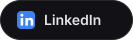</a>

 

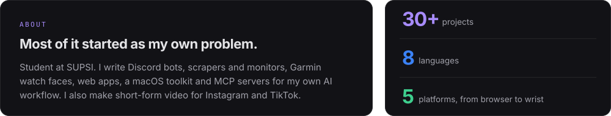

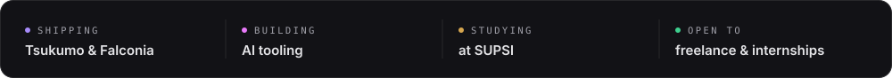

  

<picture><source media="(prefers-color-scheme: light)" srcset="assets/sec-work-light.svg">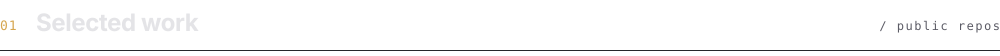</picture>

<a href="https://github.com/clackes/Tsukumo">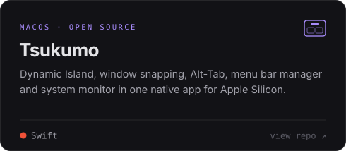</a>
<a href="https://github.com/clackes/falconia">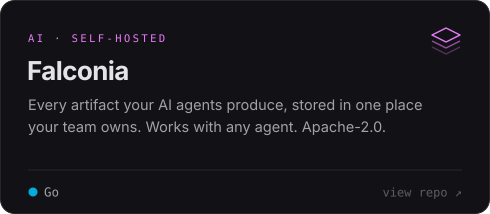</a>
<a href="https://github.com/clackes/reiatsu-relay">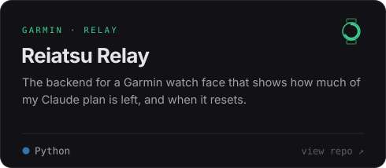</a>
<a href="https://github.com/clackes/bin-app">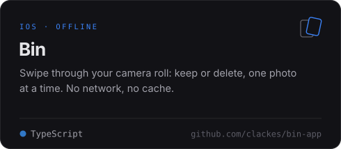</a>

  

<picture><source media="(prefers-color-scheme: light)" srcset="assets/sec-private-light.svg">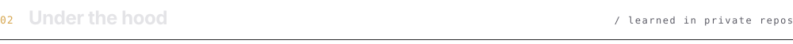</picture>

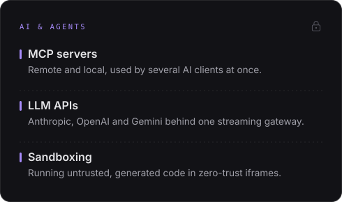
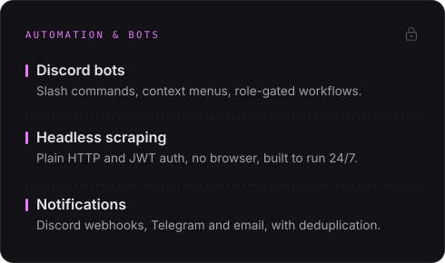
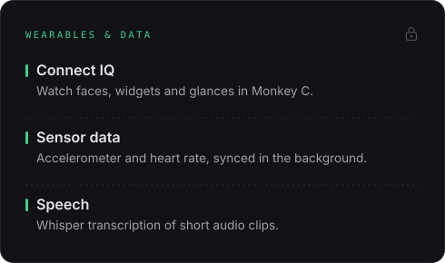
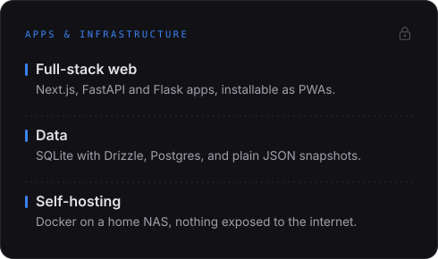

  

<picture><source media="(prefers-color-scheme: light)" srcset="assets/sec-arsenal-light.svg">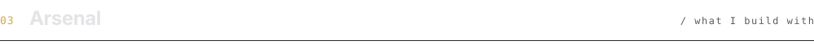</picture>

<picture><source media="(prefers-color-scheme: light)" srcset="assets/arsenal-light.svg">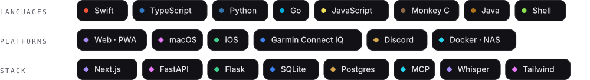</picture>

  

<picture><source media="(prefers-color-scheme: light)" srcset="assets/sec-activity-light.svg">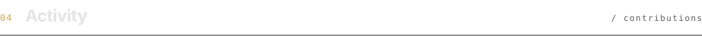</picture>

<picture>
  <source media="(prefers-color-scheme: dark)" srcset="https://raw.githubusercontent.com/clackes/clackes/output/snake-dark.svg">
  
</picture>

  

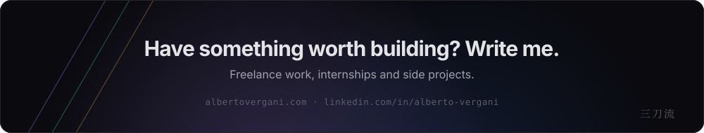

<!-- Assets are generated by scripts/build.py — edit the copy there, then run: python3 scripts/build.py -->
